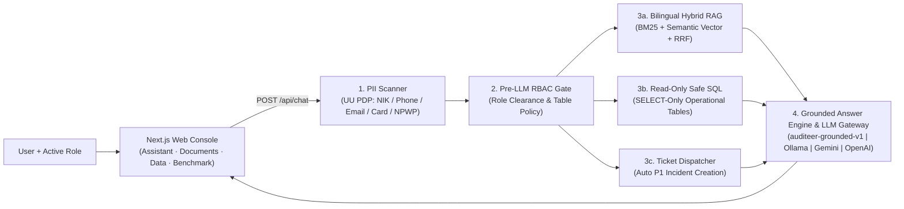

# Auditeer — Intelligent Knowledge & Operations Copilot

> A governance-first AI workspace uniting internal knowledge retrieval, read-only operational SQL analytics, zero-trust Role-Based Access Control (RBAC), and automated UU PDP PII redaction.

**Live Demo:** [https://auditeer.vercel.app](https://auditeer.vercel.app)

---

## Why Auditeer Exists

Standard chatbots and naive RAG demos break down in regulated environments for four reasons:
1. **Unstructured + Structured Silos:** Operational teams need answers grounded in **both** internal SOP documents *and* live operational data (cluster telemetry, telecom CDR quality metrics, fraud alerts, and SLA contracts).
2. **Role-Based Data Leakage:** A Junior Analyst must never receive confidential executive margins or restricted engineering SOPs, even when querying the same assistant.
3. **Privacy Compliance (UU PDP No. 27/2022):** Sensitive identifiers (`NIK` 16-digit IDs, phone numbers, emails, payment cards, `NPWP`) must be automatically masked **before** entering any model prompt or audit log.
4. **Resilience & Cost Control:** Teams need both an instant zero-key local grounded mode and optional connectors for private on-premise models (`Ollama`) or cloud providers (`Gemini` / `OpenAI`).

---

## Core Workspace Tabs

| Tab | What It Does |
| :--- | :--- |
| **Assistant** | Bilingual (Indonesian & English) Q&A combining document citations, read-only SQL tables, incident ticket dispatch, and an inspectable step-by-step execution trace. |
| **Documents** | Role-filtered Knowledge Vault with full-section document reader, live document ingestion, and Hybrid RAG search testing. |
| **Data** | Operational Lakehouse explorer (`cluster_telemetry`, `telecom_cdr_metrics`, `banking_risk_alerts`, `executive_contracts`, `incident_tickets`, `audit_logs`) with a read-only `SELECT` SQL playground. |
| **Benchmark** | 10 automated golden test cases displaying each tested `Query`, the assistant's plain-text `Answer`, expected verification rule, and pass/latency status. |

---

## Architecture Overview

Auditeer supports **two synchronized runtimes**:
- **Standalone Serverless Mode (Default on Vercel):** Built-in Next.js 15 App Router API routes (`frontend/src/app/api/*`) backed by TypeScript server modules (`frontend/src/lib/server/*`) run end-to-end without requiring a separate backend server.
- **Full Python FastAPI Mode:** Dedicated FastAPI backend (`backend/app/*`) featuring an in-memory SQLite Lakehouse, full Okapi BM25 + semantic cosine + RRF hybrid indexing, and a multi-provider LLM gateway (`auditeer-grounded-v1`, Ollama, Google Gemini, OpenAI/vLLM). Set `NEXT_PUBLIC_API_URL=http://127.0.0.1:8000` in the frontend to route browser requests to FastAPI.



---

## Automated Benchmark Suite (`10/10 Golden Cases`)

Run live in the **Benchmark** tab (`POST /api/eval/run`) or via `pytest`:

| Metric | Target | Verified Score |
| :--- | :---: | :---: |
| **Overall Suite Pass Rate** | `>= 90%` | **100% (10/10)** |
| **Hybrid Retrieval Hit@3 / MRR** | `>= 0.85` | **100% / 1.000 MRR** |
| **Pre-LLM RBAC Block Rate** | `100%` | **100% Block Rate** |
| **UU PDP PII Masking Rate** | `100%` | **100% Masking Rate** |
| **Out-of-Domain Hallucination Refusal** | `100%` | **100% Refusal Rate** |
| **Pipeline Latency (`p50` / `p95`)** | `< 500 ms` | **~2.1 ms / ~3.8 ms** |

---

## Quickstart

### Option A: Standalone Frontend + Serverless API (`:3000`)
Runs the full UI, built-in API routes, Knowledge Vault, Lakehouse SQL, and 10-case Benchmark with zero Python setup:
```bash
cd frontend
npm install
npm run dev
```

### Option B: Full-Stack with Python FastAPI Backend (`:8000` + `:3000`)

**1. Start the Python Backend (`:8000`)**
```powershell
cd backend
uv venv .venv
uv pip install -r requirements.txt --python .venv\Scripts\python.exe
.\.venv\Scripts\python.exe -m uvicorn app.main:app --host 127.0.0.1 --port 8000 --reload
```

**2. Start the Frontend (`:3000`) pointed at FastAPI**
```powershell
cd frontend
npm install
$env:NEXT_PUBLIC_API_URL="http://127.0.0.1:8000"
npm run dev
```
Or launch both windows at once with `.\start-dev.ps1`.

**3. Run Verification Tests**
```powershell
# Backend unit + benchmark suite
cd backend
.\.venv\Scripts\python.exe -m pytest -v

# Frontend TypeScript & production build check
cd ..\frontend
npx tsc --noEmit
npm run build
```

---

## Project Structure

```text
auditeer/
├── backend/
│   ├── app/
│   │   ├── main.py            # FastAPI endpoints & OpenAPI schema
│   │   ├── agent.py           # Multi-step agent orchestrator & trace builder
│   │   ├── rag_engine.py      # Bilingual Hybrid RAG (BM25 + Semantic Vector + RRF)
│   │   ├── lakehouse.py       # SQLite operational tables, Safe SQL & ticket dispatcher
│   │   ├── security.py        # RBAC role clearance profiles & UU PDP PII masker
│   │   ├── llm_gateway.py     # Local Grounded Engine, Ollama, Gemini & OpenAI gateway
│   │   └── evaluator.py       # 10-case golden benchmark runner
│   ├── data/knowledge_base/   # Sample enterprise SOP & governance Markdown docs
│   └── tests/                 # Pytest unit & benchmark suite (6/6 passing)
├── frontend/
│   └── src/
│       ├── app/
│       │   ├── api/           # Next.js serverless API routes (chat, documents, lakehouse, eval)
│       │   ├── icon.svg       # App favicon
│       │   ├── layout.tsx     # Root layout & Poppins typography
│       │   └── page.tsx       # Top navigation, role switcher & model selector
│       ├── components/        # CopilotWorkspace, KnowledgeVaultTab, LakehouseTelemetryTab, EvaluationLabTab
│       └── lib/
│           ├── server/        # Standalone serverless engine, docs, lakehouse, security & eval
│           ├── api.ts         # Typed API client
│           └── types.ts       # Shared TypeScript interfaces
├── README.md
└── start-dev.ps1
```
