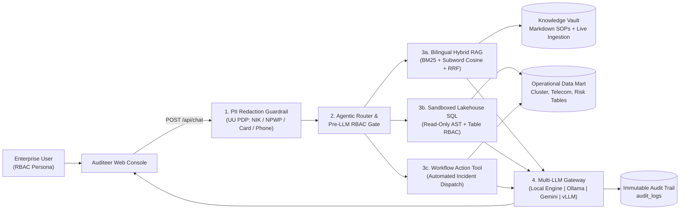

# Auditeer — Intelligent Knowledge & Operations Copilot

> An open-architecture intelligence platform bridging unstructured internal documents, real-time Lakehouse SQL telemetry, zero-trust role-based access control (RBAC), and regulatory privacy compliance.

---

## Why Auditeer Exists

Standard chatbots and basic RAG setups fail inside mission-critical organizations for four key reasons:
1. **Unstructured + Structured Data Silos:** Operational decisions require **both** internal standard operating procedures (SOPs) *and* live telemetry from data platforms (e.g. cluster health, telecommunication metrics, risk alerts).
2. **Data Leakage Across Roles:** A Junior Analyst must never receive confidential executive margins or restricted compliance records, even when asking the same assistant.
3. **Data Privacy Compliance (UU PDP No. 27/2022 & POJK 11/2022):** Sensitive personally identifiable information (`NIK` 16-digit national ID, `NPWP`, phone numbers, payment cards, emails) must be masked **before** reaching any model context or audit log.
4. **Vendor Independence & Hallucination Prevention:** Organizations require flexible inference across **local on-premise models (`Ollama` / `vLLM`)** and cloud endpoints, backed by measurable automated benchmarks.

**Auditeer** solves all four challenges through an inspectable microservice architecture (`Python FastAPI` + `Next.js TypeScript`).

---

## Architecture Overview



---

## Core Engineering Pillars

| Engineering Pillar | Implementation Details |
| :--- | :--- |
| **1. Natural Language Processing (NLP)** | Bilingual (Bahasa Indonesia + English) tokenizer, light suffix normalization, domain concept expansion, section-level contextual Markdown chunking, **Sparse BM25 Okapi** + **Subword TF-IDF Cosine Vector** search fused via **Reciprocal Rank Fusion (RRF)**. |
| **2. LLM Orchestration & Resilience** | Multi-provider runtime supporting local air-gapped **Ollama (`qwen2.5`, `llama3.2`)**, **Google Gemini**, **OpenAI / vLLM**, plus a deterministic **Local Grounded Engine** with automatic failover and hallucination guardrails. |
| **3. Structured Data & Governance** | Sandboxed read-only **NL-to-SQL engine** over operational tables (`cluster_telemetry`, `telecom_cdr_metrics`, `banking_risk_alerts`, `executive_contracts`), **Automated Incident Ticket Dispatch**, **Pre-LLM Zero-Trust RBAC**, **UU PDP PII Masking**, and immutable `audit_logs`. |

---

## Automated Benchmark Suite (`10/10 Golden Cases`)

Run live via the **Benchmark** tab or through `pytest`:

| Metric | Target | Verified Score |
| :--- | :---: | :---: |
| **Overall Suite Pass Rate** | `>= 90%` | **100.0% (10/10)** |
| **Hybrid Retrieval Hit@3 / MRR** | `>= 0.85` | **100.0% / 1.000 MRR** |
| **Pre-LLM RBAC Leak Prevention** | `100%` | **100.0% Block Rate** |
| **UU PDP No. 27/2022 PII Redaction** | `100%` | **100.0% Masking Rate** |
| **Out-of-Domain Hallucination Refusal** | `100%` | **100.0% Refusal Rate** |
| **Pipeline Latency (`p50` / `p95`)** | `< 500 ms` | **~3 ms / ~5 ms** |

---

## Quickstart

### Option A: One-Command Windows PowerShell Launch
```powershell
.\start-dev.ps1
```

### Option B: Manual Terminal Launch

**1. Start the Python Backend (`:8000`)**
```powershell
cd backend
uv venv .venv
uv pip install -r requirements.txt --python .venv\Scripts\python.exe
.\.venv\Scripts\python.exe -m uvicorn app.main:app --host 127.0.0.1 --port 8000 --reload
```

**2. Start the Frontend (`:3000`)**
```powershell
cd frontend
npm install
npm run dev
```

**3. Run the Automated Test Suite**
```powershell
cd backend
.\.venv\Scripts\python.exe -m pytest -v
```

---

## Project Structure

```text
auditeer/
├── backend/
│   ├── app/
│   │   ├── main.py            # FastAPI endpoints & OpenAPI schema
│   │   ├── agent.py           # Multi-step Agentic Orchestrator & Trace builder
│   │   ├── rag_engine.py      # Bilingual Hybrid RAG (BM25 + Dense Cosine + RRF + RBAC)
│   │   ├── lakehouse.py       # Operational Data Mart, Safe SQL & Incident Dispatcher
│   │   ├── security.py        # Role-Based Access Control & UU PDP PII Masker
│   │   ├── llm_gateway.py     # Local Engine, Ollama, Gemini & OpenAI/vLLM Gateway
│   │   └── evaluator.py       # 10-Case Automated Golden Benchmark Suite
│   ├── data/knowledge_base/   # Enterprise SOP & Governance Markdown documents
│   └── tests/                 # Automated pytest unit & benchmark suite
├── frontend/
│   └── src/
│       ├── app/               # Next.js 15 App Router shell & Navigation
│       ├── components/        # Workspace, Documents Vault, Data Explorer & Benchmark Lab
│       └── lib/               # Typed API client & data models
└── start-dev.ps1
```
